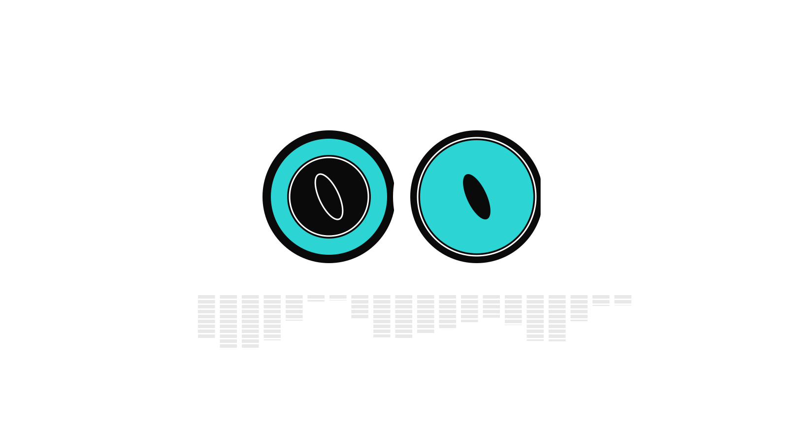
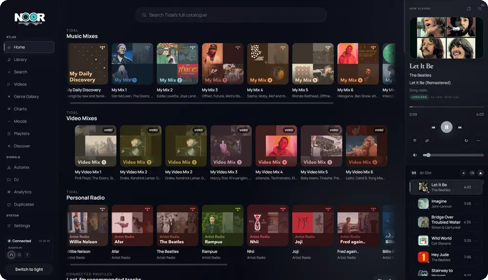
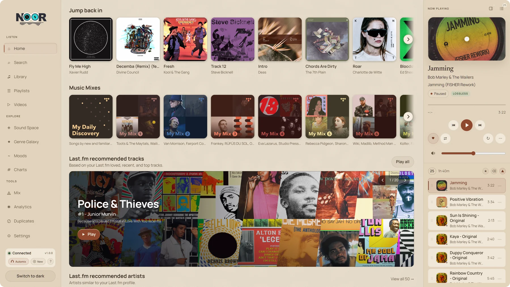
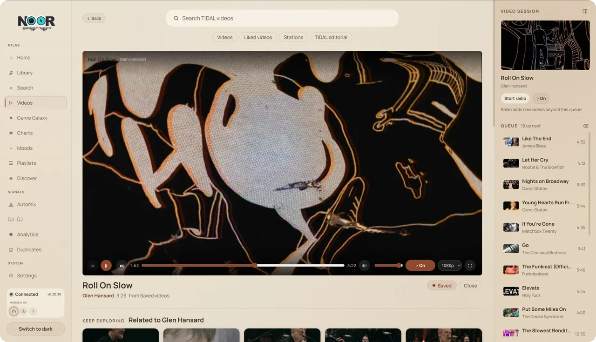
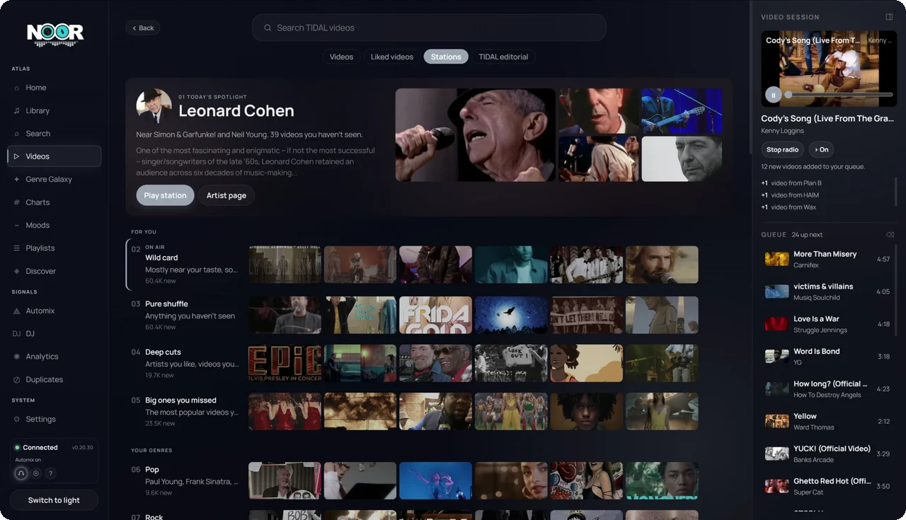
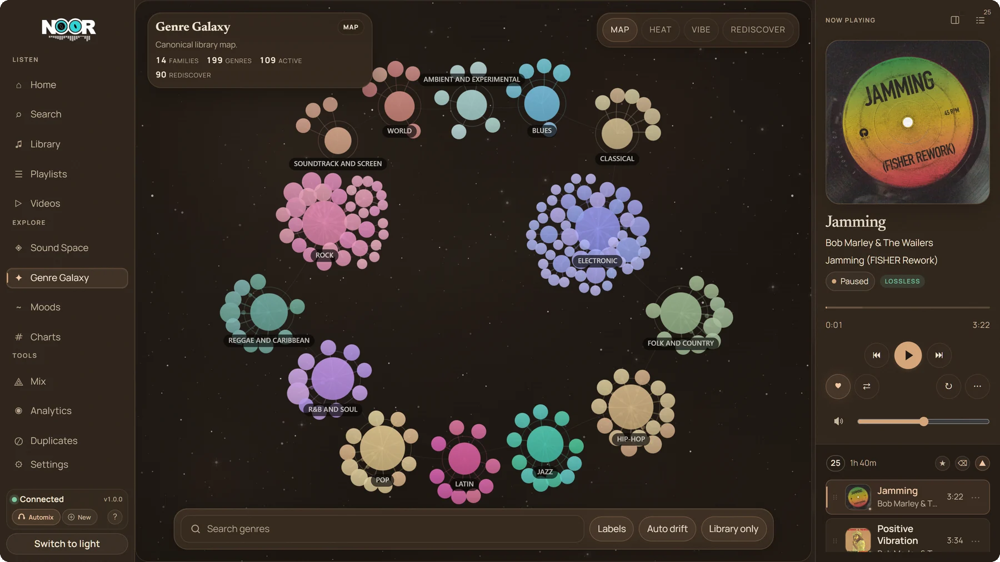
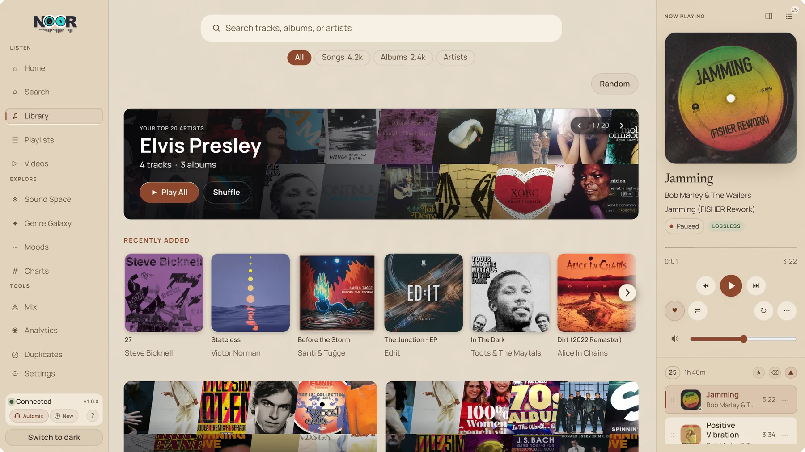
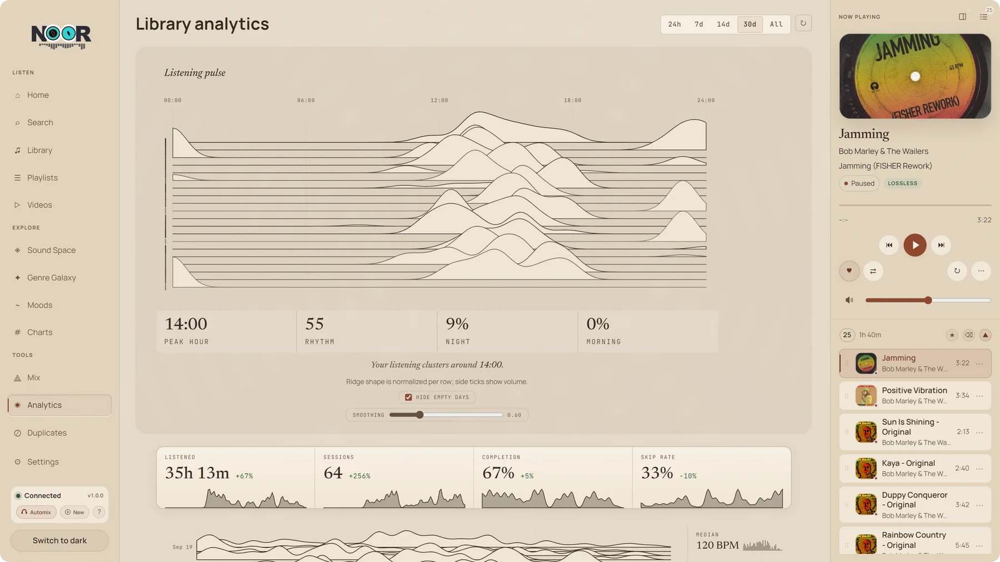

# NOORwave: TIDAL desktop music player

  

  <strong>Your TIDAL library, at local speed. Your music videos, indexed. Your genres, drawn as a galaxy.</strong>

NOORwave is a desktop music player for TIDAL built for **instant local search and fast library browsing**. Your synced library lives in a SQLite database on your own machine, so searching your saved collection runs locally. Your library and listening history stay on your disk; TIDAL supplies the audio.

**Music video indexing** finds live performances, covers, and alternate versions of tracks in your library, bringing them together in a video wall you can browse by genre and year. Video stations turn that growing catalog into a daily lineup you can keep watching. **Genre Galaxy** maps your whole library as a navigable star field. Gapless hi-fi playback, automix, planned DJ transitions, and phone remote control round out the player.

  <a href="https://noorwave.app"><strong>noorwave.app</strong></a> &middot;
  <a href="../../releases/latest"><strong>Download</strong></a> &middot;
  <a href="#connect-lastfm-seriously">Last.fm setup</a> &middot;
  <a href="#the-phone-remote-set-up">Phone remote</a> &middot;
  <a href="../../issues">Report a bug</a>

  

## Why this exists

Streaming apps are built for browsing a catalogue. They are not built for the person who has thousands of tracks saved and wants to *listen*: to know what they own, to move through it fast, to have one record land on the next without a hole in the middle.

NOORwave is that second thing. It pulls your TIDAL library down into a SQLite database on your own machine, then builds a real desktop player on top of it. Search answers instantly because it never leaves your disk. The queue is something you shape, not something that happens to you. Transitions are planned instead of stumbled into. And your own taste becomes a map you can fly through.

TIDAL stays the source of the audio. Everything else, the library, the play history, the audio analysis, the learned similarity, lives on your machine and belongs to you.

  <picture>
    <source media="(prefers-color-scheme: dark)" srcset="docs/assets/shots/home-dark.webp" />
    
  </picture>

## The parts worth showing up for

### Speed is the feature

Your whole TIDAL library is mirrored into SQLite on your disk. Search runs locally, so results land as you type: no spinner, no round trip, no rate limit. Artist pages, album pages, filters, and shuffle all read from the same local copy, and incremental sync keeps it fresh in seconds.

### Your music videos, indexed

**Discovery** is what you expect: search TIDAL's full video catalogue, play it in-app over HLS with a quality selector, autoplay through results, and pull in TIDAL's video mixes.

**Library indexing** is the part no other client does. A background pass walks the artists in your library and asks TIDAL what videos exist for the tracks you have liked, then keeps every hit. Not deduped down to one canonical clip: live takes, covers, and alternate cuts are all kept on purpose, because a richer wall beats a tidy one. Four different videos titled "Jamming" get told apart by release year and runtime. The result is a filterable wall of videos *for music you already love*, sortable by genre, year, and recency, with Play all and Shuffle across the lot. When a match is wrong, hide it once and it stays hidden through the 90-day re-scan.

Every clip plays with its own video session queue and a **Keep exploring** row of related artists underneath.

  <picture>
    <source media="(prefers-color-scheme: dark)" srcset="docs/assets/shots/video-dark.webp" />
    
  </picture>

### Video stations that keep playing

Open **Videos -> Stations** for a daily lineup drawn from your taste and the indexed catalog: a rotating artist spotlight, a wild card, pure shuffle, deep cuts, big ones you missed, and a station for each of your genres, each showing how many videos you have not seen yet. Stations refill as you watch, drawing on genres, artist relationships, tags and charts where the catalog has enough videos. The page explains when discovery is still building the catalog or there is not enough to play.

Background discovery fills in liked artists first, then explores related and new artists. Video radio and related-video suggestions use those connections, with videos you watch and enjoy helping guide the search. In **Settings -> Services -> TIDAL -> Video discovery**, choose **Full**, **Limited** for about a tenth of the requests, or **Off** to stop background discovery while retaining lookups for video radio you start.

  

### Genre Galaxy

Your library, drawn as gravity. Fourteen families, nearly two hundred genres, sized by how much of it you own and how much of it you actually play. Fly in, click a cluster, and start a session from it. Four lenses on the same map: **Map** for structure, **Heat** for what you have been playing, **Vibe** for mood, and **Rediscover** for the corners you have not touched in months. Toggle between your library's genres and TIDAL's, with auto drift on or off.

Genre runs through the rest of the player too: genre shuffle, genre-aware automix, genre video stations, and tags from MusicBrainz and Last.fm normalised into one taxonomy.

  

### Gapless is the baseline, not a checkbox

A `NearEnd` event fires 15 seconds before a track ends so the next one is already decoded and buffered when the current one runs out. On every transition the output stream is rebuilt to match the source sample rate, so a 96 kHz record plays at 96 kHz instead of being quietly resampled to whatever the device was last set to. On Windows, NOORwave drives WASAPI in exclusive mode directly, which means the OS mixer is out of the path entirely. Crossfade, DASH segment seek, media keys, and tray transport are all in the core player rather than bolted on.

### Transitions that are planned, not hoped for

The DJ cockpit reads the outgoing and incoming tracks as audio profiles and plans the cues, duration and gain changes ahead of time. Blends, cuts, bass swaps and energy changes use the available beat, phrase and harmonic evidence. **Conservative**, **Balanced** and **Adventurous** preferences guide the choices; uncertain analysis falls back to a safe crossfade.

DJ and Automix show the outgoing track, transition and incoming track together, with animation driven by confirmed playback. **Why this transition?**, **Fine Tune** and **Diagnostics** expose the reasoning and controls. Harmonic and BPM matching use Camelot key detection, tempo and energy analysis. Compatible keys get favoured, clashes get penalised, and unanalyzed tracks keep neutral scores. Seeking through a mix follows the incoming track's original audio and position, including while paused.

### Automix that learns *your* library

Automix keeps a running runway of tracks ahead of you and tells you why each one is there. It prefers learned neighbours from an embedding model trained on your own listening history, penalises hub tracks so the same twenty songs do not leak into every genre, and falls back to a session taste profile when the model has nothing to say. Clear the queue by hand and it backs off for a minute instead of immediately refilling what you just deleted. Four shuffle modes sit on a separate axis: plain, weighted by favourites and recency, genre-bucketed, and harmonically stabilised.

### Make it yours

  

- **Dock the player** on the right, the left, or as a bar along the bottom. On narrow windows it folds into a mobile layout.
- **25+ colour schemes** (Iris, Clay, Ember, Abyss, Neon, Obsidian, and more), each in light, dark, or following your system.
- **50+ animated backgrounds**: aurora ribbons, liquid chrome, spiral galaxies, stained glass, synthwave, live spectrum analysers. They pulse to the music, bend toward your cursor, and can take their colours from the album art.

### The phone in your pocket is the remote

There is a full PWA at `/remote`, served by the same process on the same port. No companion app, no second service, no cloud round trip. **Settings -> Remote -> Phone remote** owns the whole setup: enable trusted-LAN access, scan a one-use QR code (or enter its temporary six-digit code), and manage each paired phone by name. Local discovery provides a stable `.local` address when the network supports it, with a direct Wi-Fi address as the fallback. Once connected you get transport, the live queue, search, artist and album browsing, action sheets, and a sleep timer. Add it to your home screen and it behaves like a native remote.

### A library that behaves like a local collection

Incremental TIDAL sync, instant local search, artist and album pages, playlists, duplicate detection, and metadata enrichment from MusicBrainz, Last.fm, and Discogs. Anything you want on disk, you can have on disk: right-click a track, album, or playlist and save it as bit-perfect FLAC or 320 kbps MP3, tagged, into an `Artist/Album/NN - Title` tree you pick once.

TIDAL catalogue replacements preserve track identity, original library dates and explicit favorite choices through sync. Playlist search also finds user-made Spotify playlists, with fallback sources for searching, opening and saving when the metadata proxy is unavailable.

  <picture>
    <source media="(prefers-color-scheme: dark)" srcset="docs/assets/shots/library-dark.webp" />
    
  </picture>

### Listening analytics that are about listening

Not a year-end slideshow. A ridgeline of when you actually listen across the day, peak hour, session count, completion rate, skip rate, and how all of it has moved over 24 hours, 7 days, 14 days, 30 days, or all time. 

  

## Connect Last.fm. Seriously.

**This is the single highest-value thing you can do after signing into TIDAL.** NOORwave works without it, but a meaningful slice of what makes it interesting is dark until you connect it.

With a Last.fm API key in place you get:

- **Genre tags across your whole library.** This is what fills in Genre Galaxy, the genre shuffle mode, and genre-aware automix. Without it, large parts of the map are empty.
- **Similar-track radio.** Last.fm similarity is the producer behind the radio queue. Song radio and artist radio get much better reach.
- **Trending and charts data.**
- **Scrobbling** to your Last.fm profile, once you add the shared secret as well.

It also compounds: the more your library is tagged and the more listening history accumulates, the better the learned similarity model gets, which is what automix and discovery lean on.

How to set it up:

1. Create an API account at [last.fm/api/account/create](https://www.last.fm/api/account/create). It takes about a minute and is free.
2. In NOORwave, go to **Settings -> Services -> Last.fm** and paste the API key. Add the shared secret too if you want scrobbling.
3. Run the enrichment pass from the same panel. It is resumable and shows progress. Leave it running while you listen.

No Last.fm key ships with the app, so this step is on you. It is worth the minute.

## Download

Get the latest build from [noorwave.app](https://noorwave.app) or [GitHub Releases](../../releases/latest).

| Platform | File | Notes |
|---|---|---|
| Windows | `NOORwave-vX.Y.Z-windows-x64-setup.exe` | Per-user installer, updates in place. Recommended. |
| Windows | `NOORwave-vX.Y.Z-windows-x64.zip` | Portable. Unzip anywhere, run `NOORwave.exe`. |
| macOS ARM64 | `NOORwave-vX.Y.Z-macos-arm64.tar.gz` | Portable. Gatekeeper may need `xattr -cr NOORwave noor-server`. |
| macOS x64 | `NOORwave-vX.Y.Z-macos-x64.tar.gz` | Portable. |
| Linux x64 | `NOORwave-vX.Y.Z-linux-x64.tar.gz` | Portable. |

Windows builds are not CA-signed yet, so SmartScreen can warn on first launch. Updates are signed and verified by the app before they install. Installed copies update themselves from noorwave.app.

## The Phone Remote, Set Up

In the installed desktop app:

1. Open **Settings -> Remote -> Phone remote** and enable **Allow phone remote**. Use this only on a trusted local network.
2. Optional: enable **Start NOORwave in the tray when I sign in** so the remote is available without opening the main window first.
3. Select **Pair phone**, then scan it with the phone's camera. If NOORwave is already installed on the phone's home screen, enter the temporary six-digit code instead. The QR and code expire after two minutes and work once.
4. Open the paired remote and optionally add it to the phone's home screen. The device receives its own persistent credential; the permanent master PIN is not embedded in the QR.

If the friendly `.local` address does not open, choose the direct Wi-Fi address under **Use a different connection address**, refresh the QR, and pair that origin separately. Windows may show a firewall prompt the first time LAN access is enabled; allow NOORwave on private networks. Phone Remote is same-LAN only: no cloud relay, port forwarding, or internet discovery.

## Bugs and ideas

Bug reports are genuinely useful. Open an [issue](../../issues) with a screenshot and the version string from the sidebar.

## Disclaimer

NOORwave uses TIDAL's unofficial API through PKCE OAuth2. It is not affiliated with, endorsed by, or associated with TIDAL Music AS or MQA Ltd. Credentials are stored locally, encrypted, in SQLite. Intended for personal use only.

## License

Copyright 2026 biggiesmallcap-blip. All rights reserved.

NOORwave's source code is not public. The app is free to download and use for personal, non-commercial listening.

Source code previously published here (up to and including v1.1.0) was released under the [PolyForm Noncommercial License 1.0.0](https://polyformproject.org/licenses/noncommercial/1.0.0), and earlier releases under MIT. Those copies remain under their original terms. Later versions are not covered by either license.
